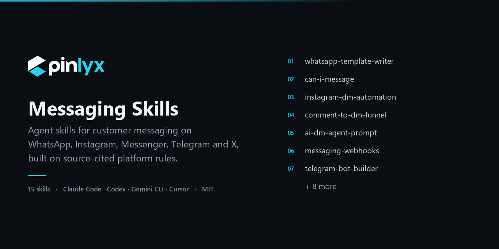

# messaging-skills

[](https://github.com/Pinlyx/messaging-skills/actions/workflows/ci.yml) [](LICENSE) [](skills)



**Fifteen agent skills that teach your AI assistant how to message customers on WhatsApp, Instagram, Messenger, Telegram and X without breaking the platform rules.**

Works with Claude Code, Codex, Gemini CLI, Cursor and any agent that reads the Agent Skills format (a folder with a `SKILL.md`).

## Why it exists

Ask a general-purpose assistant to "write a WhatsApp follow-up for customers who did not reply last week" and it will happily draft one. It will not tell you that free-form messages are only allowed for 24 hours after the customer's last message, that a template needs the right category and an opt-in, or that the Instagram version of the same idea is not possible through the official API. The same happens with:

- Instagram and Messenger bots using the `HUMAN_AGENT` tag, which is for a person replying manually, not for automation or promotions;
- Messenger code still sending `ACCOUNT_UPDATE` or `POST_PURCHASE_UPDATE` tags, retired on 2026-04-27;
- Telegram bots that try to start a chat with a username;
- AI DM agents that invent prices, answer in the wrong language, keep talking when a person should take over, or obey instructions hidden in a customer message;
- comment-to-DM funnels that plan a three message sequence when the platform allows one private reply.

These skills put that knowledge into the agent's context at the moment it is needed: concrete workflows, checklists and output templates, with every platform number traced to an official page.

## Skills

| Skill | What it does | Example trigger |
| --- | --- | --- |
| [`whatsapp-template-writer`](skills/whatsapp-template-writer/SKILL.md) | Writes WhatsApp templates that pass review: category choice, variables and examples, buttons, rejection fixes | "Write a utility template for shipping updates" |
| [`can-i-message`](skills/can-i-message/SKILL.md) | Decision tree for "may I message this person now" per channel: windows, tags, opt-in | "Customer wrote 30 hours ago, can my bot reply?" |
| [`instagram-dm-automation`](skills/instagram-dm-automation/SKILL.md) | Designs and audits Instagram DM automation inside the rules, with handoff | "Automate our Instagram DMs" |
| [`comment-to-dm-funnel`](skills/comment-to-dm-funnel/SKILL.md) | Keyword comment to private reply funnel for Instagram and Facebook, copy and measurement | "Comment GUIDE and get the link" |
| [`dm-reply-writer`](skills/dm-reply-writer/SKILL.md) | Writes channel-appropriate replies grounded in facts, with a clear handoff moment | "Reply to this customer in Turkish" |
| [`ai-dm-agent-prompt`](skills/ai-dm-agent-prompt/SKILL.md) | Writes and audits the system prompt of a DM agent and a test plan based on dm-bench | "My bot makes up prices" |
| [`broadcast-compliance`](skills/broadcast-compliance/SKILL.md) | Audits a campaign for opt-in, channel rules, pacing and quality risk | "Can I send this promo to my list?" |
| [`messaging-webhooks`](skills/messaging-webhooks/SKILL.md) | Meta, Telegram and X webhooks: challenge, signature on the raw body, retries, idempotency | "Webhook signature check fails" |
| [`telegram-bot-builder`](skills/telegram-bot-builder/SKILL.md) | BotFather to production: webhook or polling, commands, inline keyboards, limits | "Build a Telegram support bot" |
| [`telegram-channel-growth`](skills/telegram-channel-growth/SKILL.md) | Analyzes a public channel with telegram-channel-stats and plans growth experiments | "Why are my channel views low?" |
| [`contact-channel-audit`](skills/contact-channel-audit/SKILL.md) | Audits which contact channels a website offers with contact-channel-detector | "Does this site offer WhatsApp?" |
| [`inbox-triage`](skills/inbox-triage/SKILL.md) | Classifies and prioritizes a multi-channel inbox with reply-by times that respect windows | "What should I answer first?" |
| [`support-macros`](skills/support-macros/SKILL.md) | Builds a multilingual canned reply library that fits channel limits | "Create saved replies for WhatsApp and Instagram" |
| [`messaging-kpis`](skills/messaging-kpis/SKILL.md) | Defines and reports response time, resolution, handoff, window-miss and conversion KPIs | "Weekly messaging report" |
| [`local-lead-list`](skills/local-lead-list/SKILL.md) | Builds a local business list from open map data, enriches it with contact channels, plans compliant outreach | "Find dentists in Lyon and check who uses WhatsApp" |

## Install

### Claude Code

```
/plugin marketplace add Pinlyx/messaging-skills
/plugin install messaging-skills@messaging-skills
```

The repository root is itself the plugin: `.claude-plugin/marketplace.json` lists one plugin with `"source": "./"`, and `.claude-plugin/plugin.json` describes it. Claude Code finds the skills in `skills/` by convention, so the skill files exist once. Skills are invoked as `/messaging-skills:can-i-message` and so on, and the agent also loads them on its own when a request matches their description.

### skills.sh and any agent that supports it

```
npx skills add Pinlyx/messaging-skills
```

`skills.sh.json` points at `./skills`.

### Gemini CLI

```
gemini extensions install https://github.com/Pinlyx/messaging-skills
```

The extension loads `GEMINI.md`, which lists the skills and tells the agent to read the matching `skills/<name>/SKILL.md`.

### Codex, Cursor and other agents (manual)

Agent Skills are plain folders. Clone the repository and copy the skill folders you want into your agent's skills directory (see your agent's documentation for the exact location; for example `~/.codex/skills/` for Codex CLI, or `.cursor/skills/` inside a Cursor project):

```
git clone https://github.com/Pinlyx/messaging-skills
cp -r messaging-skills/skills/* <your-agent-skills-directory>/
```

If your agent has no skills directory, paste the relevant `SKILL.md` into the conversation or reference it from your project instructions file.

## Quick start

After installing, just describe the task in your own words. The agent picks the skill from its description, asks for the missing context and returns the output template. For example:

```
A customer asked about delivery on Instagram yesterday morning. Can our bot send a
reminder today?
```

The agent loads `can-i-message`, asks for the exact time of the customer's last message and who sends, and answers with a verdict, the window end time, what is allowed instead and the official sources. Another one:

```
Write a WhatsApp template that tells customers their appointment is tomorrow.
```

loads `whatsapp-template-writer`: it classifies the message as utility, writes the body with realistic variable examples and lists the rejection risks.

## Where the rules come from

Every platform number in these skills (window lengths, tags, character limits, attachment and button limits, rate limits) comes from the source-cited data in [messaging-rules](https://github.com/Pinlyx/messaging-rules). Each value there carries the official URL it was read from, a short quote and a verification date (last verified 2026-11-20). The skills copy the values they use into their own `references/` folder together with the URL, for example [`skills/can-i-message/references/channel-rules.md`](skills/can-i-message/references/channel-rules.md).

Official pages only: `developers.facebook.com`, `core.telegram.org` and `docs.x.com`. If a value could not be confirmed, the skills say "no published number in the rules data, check the official page" instead of guessing. Examples: WhatsApp template header, body and button lengths, per-user marketing caps, Instagram marketing messages, the maximum length of an X direct message, the maximum number of Telegram inline buttons.

Platforms change these rules. Check the verification date and the linked page before relying on a value for something expensive, and open an issue if something is out of date.

## Sibling open source tools

The skills name these tools as optional helpers. None of them is required.

| Tool | What it does | Used by |
| --- | --- | --- |
| [`messaging-rules`](https://github.com/Pinlyx/messaging-rules) (npm) | The rules data as a library and an MCP server: `npx -y -p messaging-rules messaging-rules-mcp` exposes `check_messaging_window`, `validate_message`, `get_channel_rules` | `can-i-message`, `support-macros`, `broadcast-compliance` |
| [`unified-message`](https://github.com/Pinlyx/unified-message) (npm) | Normalizes WhatsApp, Instagram, Messenger, Telegram and X webhooks and verifies their signatures | `messaging-webhooks` |
| [`dm-bench`](https://github.com/Pinlyx/dm-bench) | 70 scenarios that benchmark an AI agent answering customer DMs | `ai-dm-agent-prompt` |
| [`telegram-channel-stats`](https://github.com/Pinlyx/telegram-channel-stats) | Subscribers, views, reach and posting frequency of any public Telegram channel | `telegram-channel-growth` |
| [`contact-channel-detector`](https://github.com/Pinlyx/contact-channel-detector) | Detects the contact channels a website offers | `contact-channel-audit`, `local-lead-list` |
| `Pinlyx/messaging-mcp` (coming soon) | Self-hosted MCP server for messaging through the official APIs | Planned |
| `Pinlyx/open-business-finder` (coming soon) | Business lists from open map data | `local-lead-list` |

## How a skill is built

Each skill is `skills/<name>/SKILL.md` with a frontmatter (`name` equal to the folder, a `description` of at most 1,024 characters that says when to use it) and the sections When to use, Context to collect, Workflow, Checklist, Output template and Common mistakes. Sourced rules and long tables live in `skills/<name>/references/`. Agents load the short description first and the full file only when a request matches, so the library stays cheap to carry.

## Limits

- These are guidance for an assistant, not legal advice and not a compliance guarantee. Consent and marketing law differs by country; ask counsel.
- The skills cannot check what only your accounts know: opt-in records, App Review permissions, template approval status or quality ratings.
- Platform rules change without notice. The skills show what was verified on 2026-11-20.
- The skills never send messages by themselves. They help the agent decide, draft and review; sending is up to you and your tools.

## Validate and contribute

```
node scripts/validate.mjs
```

checks frontmatter, required sections, internal links, manifests and content rules (Node 18 or newer, no dependencies). It runs in CI on every push. See [CONTRIBUTING.md](CONTRIBUTING.md): a new skill needs a sourced `references/` file for every platform number it uses.

## License

MIT, see [LICENSE](LICENSE).

Built and maintained by [Pinlyx](https://pinlyx.com/?utm_source=github&utm_medium=readme&utm_campaign=messaging-skills), the omnichannel inbox and AI agent for Telegram, WhatsApp, Instagram, Messenger, X, email and live chat.
